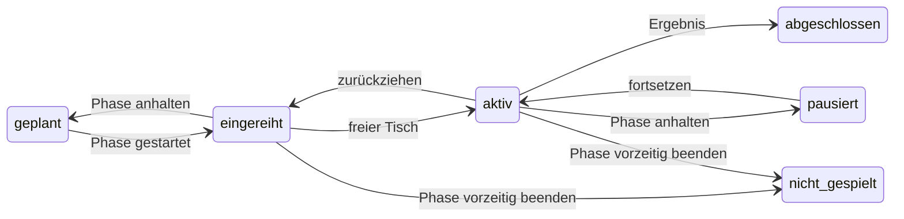
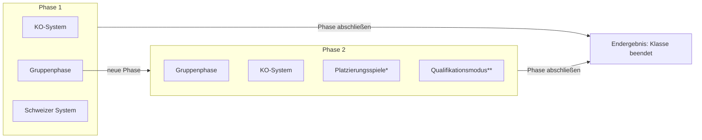

<!--
  HTS – Dokumentation (Markdown-Quelle)
  Diese Datei ist die fortschreibbare Fassung der Dokumentation. Für neue Versionen:
  einfach diese Datei (am besten zusammen mit dem Quellcode-ZIP) wieder an Claude geben
  und um die Änderungen der neuen Version erweitern lassen.
  Stand: 11.11.2026 · Programmversion 0.41.0
-->

# HTS – Hamburger Turniersoftware: Dokumentation

Stand: 11.11.2026 · Programmversion **0.41.0**

## Versionsverlauf der Dokumentation

| Datum | Programmversion | Änderung |
| --- | --- | --- |
| 11.11.2026 | 0.41.0 | Nachtrag der Versionen 0.31.0–0.41.0: Vorgabeturnier sowie 2er und 3er Turnier, Anwesenheit am Turniertag (Meldungen, „Angemeldet“, Startsperre für importierte Klassen), Handy-Zugang mit Live-Anzeige und Anmeldung per QR-Code (Seite „Mobile Einstellungen“), Setzplatz und durchsuchbarer Vereinsfilter, Qualifikationsmodus überarbeitet (KO-Qualifikation je Gruppe oder insgesamt, Runden einzeln starten, Entscheidung nach Runde 1, Herkunft „A2“), KO-Folgephase mit bestimmten Gruppenplätzen, Phase vorzeitig beenden bzw. neu starten, feste Spielreihenfolge in Gruppen, Vereinsgleichheit „Schwächster zu Stärkstem“, Tischzuordnung „Haken = darf spielen“, kompakter Klassenkopf, Texte nie abgekürzt, Satzeingabe ohne Vorzeichen |
| 04.11.2026 | 0.30.0 | Nachtrag 0.29.0 und 0.30.0: Präsentationsansicht für den zweiten Bildschirm (Auswahl je Klasse mit Status, Seiten ohne zerschnittene Karten, Gruppen im 2×2-Raster, Tische nach Auflösung), Info-Knopf und Lizenz GPL 3.0, kompakter Kopfbereich, Klasse öffnet die aktuellste Phase, Setzung „Gruppenkopf gesetzt“, Import (Einzel direkt in die Klasse, Doppel ohne Partner/in unter „Verfügbar“), Vereinsfilter nur noch im Doppel, Suche und automatisches Blättern bei den Doppelpaarungen, Doppel-TTR bei fehlenden Werten, festes Los als letztes Kriterium in Tabellen |
| 03.11.2026 | 0.28.0 | Nachtrag der Versionen 0.21.0–0.28.0: Testturnier und Simulation, Turnier kopieren, fertiges Turnier aus click-TT importieren, Suche über Vorname/Nachname/Verein (auch im KO-Baum, Enter springt zum nächsten Treffer), KO-Baum mit Pfaden, fixierten Rundentiteln und Statusfarben, Schalter „Spiel um Platz 3“, Doppelregeln und „Partner zulosen“, Qualifikationsmodus neu (HEM-Logik, Nachrücker je Gruppe, freie Auslosung, Zusatzrunde), Tische benennen und deaktivieren, neue PDFs (KO-Turnierbaum, Gruppen zweispaltig), Leistung und Hardware |
| 31.10.2026 | 0.20.0 | Spiel um Platz 3, Gewinnsätze je Klasse (3/4), „A1“-Kennungen im KO-Baum der Phase 2, Schweizer System ohne Folgephase, Vereinsgleichheit in der Qualifikation, neue Speicherorte „Dokumente\HTS Turniere“ |
| 31.10.2026 | 0.19.0 | höchstens 2 Phasen je Klasse; Qualifikationsmodus neu: Nachrückerränge, Verlierer spielen weiter, Q = 0 möglich, geteilte Gruppenplätze |
| 30.10.2026 | 0.18.0 | Qualifikationsmodus (Abschnitt 8), Vereinsnamen in KO-Darstellungen |
| 30.10.2026 | 0.17.0 | erste vollständige Fassung |

## 1. Überblick

HTS (Hamburger Turniersoftware) organisiert Tischtennisturniere von der Meldeliste bis zur click-TT-Ergebnisdatei. Diese Dokumentation beschreibt Version 0.41.0. HTS ist freie Software unter der GNU Affero General Public License v3.0 oder später (AGPL-3.0-or-later, seit 0.42.0; bis 0.41.0 GPL 3.0); Wünsche und Fehler nimmt das GitHub-Projekt als Issue entgegen (Label „Feature“ bzw. „bug“).

Das Programm deckt den ganzen Turniertag ab:

- Teilnehmende aus click-TT importieren oder von Hand erfassen
- Klassen (Konkurrenzen) anlegen und Teilnehmende zuordnen, auch Doppel
- Modus festlegen und auslosen: KO-System, Gruppenphase oder Schweizer System
- bis zu zwei Phasen je Klasse, z. B. Gruppen, dann KO-System
- Tische automatisch belegen, Spielzettel drucken, Ergebnisse Satz für Satz erfassen
- Endergebnisse als PDF und die Ergebnisdatei für den click-TT-Upload erzeugen
- Qualifikationen nach dem Muster der Hamburger Einzelmeisterschaften (HEM): Vor- und Hauptqualifikation mit Nachrückerrängen
- zum Üben: Testturniere, in denen alle Spiele per Knopfdruck simuliert werden
- eine Präsentationsansicht für einen zweiten Bildschirm (Beamer, Fernseher) mit wechselnden Ansichten
- Anwesenheit am Turniertag erfassen, auch per Handy über einen QR-Code; eine Live-Anzeige für die Handys der Teilnehmenden im lokalen WLAN (Abschnitt 11)
- Vorgabeturniere mit Punktevorsprung nach TTR sowie 2er und 3er Turniere (Mannschaftskämpfe; Abschnitt 12)

### Systemvoraussetzungen

| Punkt | Mindestens | Empfohlen |
| --- | --- | --- |
| Betriebssystem | Windows 10 oder 11, 64 Bit (x64) | Windows 11 |
| Java | nicht nötig, eine Java-Laufzeit (Temurin 21) liegt bei | – |
| Prozessor | Zweikern-Prozessor der letzten rund 10 Jahre | Vierkern-Prozessor |
| Arbeitsspeicher | 4 GB | 8 GB |
| Speicherplatz | ca. 200 MB für das Programm, wenige MB je Turnier | – |
| Bildschirm | 1366 × 768 Pixel (auch mit 125 % oder 150 % Windows-Skalierung) | 1920 × 1080 oder größer; für die Turnierleitung gern ein zweiter Bildschirm |
| Grafik | beliebig; ohne passenden Grafiktreiber (z. B. in einer virtuellen Maschine) zeichnet JavaFX per Software – langsamer, aber lauffähig | aktueller Grafiktreiber (Direct3D) |
| Drucker | optional; für Spielzettel ein Standarddrucker, ideal mit A6-Papier | – |
| Internet | nicht nötig, HTS läuft vollständig offline | – |
| WLAN-Router | nur für den Handy-Zugang (Abschnitt 11): Laptop und Handys im selben WLAN, ohne Internetanschluss | Haupt-WLAN eines Routers, kein Gäste-WLAN |

Windows auf ARM-Prozessoren sollte über die x64-Emulation von Windows 11 funktionieren, ist aber nicht geprüft.

### Leistung

Gemessen mit einem großen Testturnier (1500 Teilnehmende, 40 Tische, KO-Felder mit 32, 64, 128 und 256 Plätzen, Gruppenphase mit 300 Spielern in 60 Gruppen) auf einem Zweikern-Rechner (Xeon, 2,1 GHz) mit Software-Darstellung. Auf einem Windows-PC mit Grafikbeschleunigung ist die Darstellung eher schneller.

| Vorgang | Dauer |
| --- | --- |
| 1500 Teilnehmende importieren / zusammenführen | ca. 5 ms |
| KO-Feld mit 128 auslosen (Setzung und Vereinsprüfung) / 60 Gruppen auslosen | ca. 2 ms / ca. 7 ms |
| Ergebnis eintragen inkl. neuer Tischvergabe | unter 0,1 ms je Spiel |
| Phase 2 (KO aus 60 Gruppen) anlegen | ca. 20 ms |
| Turnierdatei speichern / laden (ca. 460 KB) | ca. 45 ms / ca. 80 ms |
| Suche über 1500 Personen | ca. 5 ms |
| Ansicht öffnen: KO-Baum 128er-Feld / 256er-Feld | ca. 0,4 s / ca. 0,4–1,2 s |
| Ansicht öffnen: Gruppenphase mit 60 Gruppen | ca. 0,8–1 s (beim allerersten Öffnen bis 2,5 s) |

Speicher: Die Turnierdaten selbst brauchen nur wenige MB. Den meisten Platz belegt die gerade angezeigte Ansicht – ein 256er-KO-Baum rund 190 MB, eine Gruppenphase mit 60 Gruppen rund 260 MB Java-Speicher. Beim Wechsel der Ansicht wird der Speicher wieder frei (gemessen: kein Anwachsen bei wiederholtem Wechsel). Mit Java-Laufzeit, Grafik und Puffern belegt der Prozess bei solchen Ansichten bis rund 1 GB Arbeitsspeicher; daher die Empfehlung von 8 GB. Bei üblichen Turnieren (bis etwa 64er-Felder, 20 Gruppen) ist es deutlich weniger.

### Installation und Start

1. Die Datei `hts-<Version>-windows.zip` in einen beliebigen Ordner entpacken (Rechtsklick → „Alle extrahieren …“, nicht direkt aus dem ZIP starten).
2. Im Ordner `hts-dist` auf **HTS starten.bat** doppelklicken.
3. Es öffnet sich die Turnierübersicht. Eine Installation oder Administratorrechte sind nicht nötig.

Für ein Update wird die neue ZIP-Datei ebenso entpackt. Die Turniere liegen getrennt vom Programm und bleiben erhalten. Meldet die Startdatei „keine Java-Laufzeit gefunden“, fehlt neben `hts.jar` der Ordner `jre` – meist wurde aus dem ZIP heraus gestartet oder die Startdatei verschoben (für den Desktop nur eine Verknüpfung anlegen).

### Wo die Daten liegen

Stammordner ist `Dokumente\HTS Turniere` (auch wenn der Dokumente-Ordner per OneDrive umgeleitet ist). Jedes Turnier bekommt dort einen eigenen Ordner mit seinem Namen:

```
Dokumente\HTS Turniere\
    Herbstturnier 2026\
        Turnierdatei\    Herbstturnier 2026.hts (und die Kopie der click-TT-Importdatei)
        XML Export\      click-TT-Ergebnisdatei „Ergebnisse - … .xml“
        PDF Export\      alle PDFs: Gesamtergebnis, Phasen, Endergebnisse, Spielzettel
```

- Die Ordner entstehen automatisch. Gibt es den Turniernamen schon, heißt der Ordner z. B. „Herbstturnier 2026 (2)“.
- **Turnierdatei woanders:** Beim Anlegen (und unter **Bearbeiten**) wählt **Durchsuchen** einen anderen Ordner; HTS merkt sich die Datei und zeigt sie weiter in der Übersicht.
- **Exporte woanders:** Im Speichern-Dialog (PDF-Viewer bzw. click-TT-Export) einfach einen anderen Ordner wählen. Dieser Ordner gilt für dieses Turnier, bis wieder ein anderer gewählt wird.
- Turniere aus der alten Ablage `<Benutzerordner>\HTS\Turniere` werden beim ersten Start ab Version 0.20.0 automatisch in die neue Struktur übernommen; die alten Dateien heißen danach `….hts.uebernommen`.

Gespeichert wird automatisch nach jeder Änderung.

## 2. Programmaufbau und Bedienung

HTS hat zwei Ebenen: die Turnierübersicht und die Ansicht eines geöffneten Turniers mit ihren Seiten.

### Kopfleiste

Die dunkelblaue Kopfleiste zeigt links das HTS-Logo und daneben das geöffnete Turnier („Turnier: Name · Datum“, bei Testturnieren „TESTTURNIER: …“). Darunter liegt das Menü, rechts oben der runde Knopf zurück zur Turnierübersicht. Bei Testturnieren steht daneben ein Würfel-Knopf (Abschnitt 3). Ganz rechts steht immer der **Info-Knopf (i)**: Er zeigt Version, Signatur, die Lizenz (AGPL 3.0) samt Lizenzhinweis, Links zur Feature- und Bug-Sammlung auf GitHub sowie die Lizenzen der mitgelieferten Bibliotheken. In der Turnierübersicht gibt es nur den Info-Knopf; neue Turniere legt der Knopf **Neues Turnier** auf der Seite an.

| Menüpunkt | Zweck |
| --- | --- |
| ← Turniere | zurück zur Turnierübersicht |
| Teilnehmende | Meldeliste: importieren, erfassen, suchen |
| Klassen | Klassen anlegen, Teilnehmende zuordnen, Modus festlegen, Phasen und Endergebnis |
| Tische | belegte und freie Tische, Warteschlange, Tischzuordnung, Tischnamen |
| Spiele | alle Spiele klassenübergreifend, Suche, Ergebnisse und Korrekturen, Export-Markierung |
| Präsentationsansicht | Anzeige auf einem zweiten Bildschirm starten, Wechselzeit und Ansichten wählen (Abschnitt 6) |
| Mobile Einstellungen | Handy-Zugang starten und beenden, QR-Codes drucken, Anmeldung per Adresse sperren (Abschnitt 11) |
| Vorgaberegeln | nur im Vorgabeturnier: Art der Vorgabe und Grenzen (Abschnitt 12) |

„Spiele“ ist ausgegraut, bis das Turnier oder eine Klasse gestartet ist. Wird das Fenster schmal, bricht das Menü in eine zweite Zeile um; unter 1200 Pixeln Breite entfällt der Schriftzug „Hamburger Turniersoftware“, der Turniername bricht notfalls um.

### Bedienregeln

- **Automatisches Speichern:** Jede Änderung wird sofort gespeichert; es gibt keinen Speichern-Knopf.
- **Drag & Drop:** Teilnehmende, Doppelpartner, Gruppenmitglieder und KO-Plätze werden mit der Maus gezogen. Erreicht der Mauszeiger beim Ziehen den oberen oder unteren (im KO-Baum auch linken oder rechten) Rand der Ansicht, blättert sie automatisch weiter – je näher am Rand, desto schneller.
- **Suche:** Alle Suchfelder in Klassen, Gruppenphase, KO-Baum und auf der Seite „Spiele“ suchen in **Vorname, Nachname und Verein**. Mehrere Wörter (durch Leerzeichen getrennt) müssen alle passen, jedes darf in einem der drei Felder stehen, auch als Wortteil; Groß-/Kleinschreibung, Umlaute (ü = ue), Reihenfolge und Satzzeichen am Wortrand spielen keine Rolle. Beispiel Richard Michaelis, Grün-Weiß Harburg: Treffer bei „Richard Michaelis“, „Michaelis Harburg“, „richard grün“ oder nur „Harburg“ (dann auch alle anderen aus Vereinen mit „Harburg“ im Namen). Doppel werden gefunden, wenn eine der beiden Personen passt.
- **KO-Darstellungen** (KO-Baum, Spiele der KO-Qualifikation, Spielplan im PDF) zeigen hinter jedem Namen den Verein.
- **Doppelklick:** öffnet in Gruppenübersicht, KO-Baum und Spieleliste die Ergebniseingabe.
- **Texte werden nie abgekürzt** („…“ gibt es nicht): Knöpfe sind immer ausgeschrieben, wird es eng, bricht eine Knopfzeile um. Tabellenspalten sind so breit wie ihr Inhalt (notfalls mit waagerechter Scrollleiste), KO- und Qualifikationskarten so breit wie der längste Name samt Verein. Reicht die Höhe nicht, scrollt die Seite.
- **Dialoge** passen ihre Größe dem Inhalt an; auf kleinen Bildschirmen scrollen sie, statt abzuschneiden.
- **Auswahlmenüs** haben zwei Formen: Menüs, die etwas *tun* oder einstellen, sind weiß mit Rahmen und sagen, wozu sie dienen (z. B. „Aktion für Markierte wählen ▾“, „PDF / Drucken ▾“, „Gleichstand: … ▾“); Filter sind hellgrau gefüllt (z. B. „Alle ▾“).
- **Durchsuchbare Auswahl** (Vereinsfilter): Tippen filtert nur die aufklappende Liste – ein Teil des Namens genügt, Groß-/Kleinschreibung egal. Mit den Pfeiltasten bewegt man sich in der Liste; erst **Enter** oder ein Klick wählt den Eintrag und filtert die Tabelle. **Esc** oder Verlassen des Feldes stellt den bisherigen Wert wieder her; leeres Feld + Enter = „Alle“.
- **Kopfbereich einer Seite:** Unter dem Seitentitel stehen Turniername, Datum und – sobald gestartet – „● Gestartet hh:mm Uhr“. Rechts oben stehen die Knöpfe der Seite: „Turnier starten“, „Bereite Klassen starten“, nach Turnierende „Ergebnisse exportieren“ und auf der Seite „Klassen“ **Klasse anlegen**.

## 3. Turniere und Teilnehmende

### Turniere anlegen und verwalten

In der Turnierübersicht legt **Neues Turnier** ein Turnier an. Pflicht sind Name, Datum und die Anzahl der Spieltische; das Turnier ist sofort gespeichert.

- Jede Karte zeigt Datum, Anzahl Teilnehmende und Klassen sowie den Status.
- **Öffnen** oder Doppelklick öffnet das Turnier, **Bearbeiten** ändert Name, Datum, Spieltische und den Ort der Turnierdatei, **Löschen** entfernt die Turnierdatei (Exporte bleiben erhalten).
- Beim Anlegen zeigt der Dialog, wo die Turnierdatei landet (Standard: `Dokumente\HTS Turniere\<Name>\Turnierdatei`); **Durchsuchen** wählt einen anderen Ordner (Abschnitt 1).
- **Turnierdatei übernehmen** holt eine vorhandene `.hts`-Datei als neues Turnier herein.
- **Fertiges Turnier importieren (click-TT)** liest eine click-TT-Ergebnisdatei (Format TournamentPortal, egal ob aus click-TT, poinTT oder HTS) und legt daraus ein neues, abgeschlossenes Turnier an: je Konkurrenz eine Klasse, Phase 1 als Gruppenphase oder KO-System (inkl. Spiel um Platz 3), alle Spiele mit Sätzen und die Platzierungen. Nicht Angetretene stehen ohne Klasse in der Teilnehmendenliste. Spätere Phasen aus der Datei werden nicht übernommen, sondern im Bericht genannt; Unstimmigkeiten erscheinen als Hinweise statt eines Abbruchs.
- **Kopie von:** Beim Anlegen lässt sich ein bestehendes Turnier als Vorlage wählen – **ohne Auslosung** (Teilnehmende, Klassen, Zuordnungen, Einstellungen, Tische; Standard), **alles** (inkl. Auslosungen, Spielen und Ergebnissen) oder **nur Teilnehmende** (ohne Klassen). Das Original bleibt unverändert.
- **Vorgabeturnier:** Option beim Anlegen (später nicht umschaltbar); siehe Abschnitt 12.
- **Testturnier:** Das Häkchen beim Anlegen bzw. Bearbeiten markiert ein Übungsturnier (Karte „Testturnier“). Dort trägt der Würfel-Knopf in der Kopfleiste **alle offenen Spiele der laufenden Phasen** zufällig und regelgerecht ein (Best of 5 bzw. 7, Verlängerung bis höchstens 20:18), inklusive der Folgerunden im KO- und Schweizer System – ohne Spielzettel zu drucken und ohne Phasen abzuschließen. Angehaltene Phasen werden nicht simuliert. Exporte sind auch für Testturniere möglich.

### Teilnehmende aus click-TT importieren

Auf der Seite „Teilnehmende“ liest **XML der Teilnehmenden importieren** den Turnierexport aus click-TT ein.

1. XML-Datei wählen; HTS zeigt eine Vorschau mit Teilnehmenden und Konkurrenzen. Jede Konkurrenz hat einen Haken **„Importieren“**: Abgewählte Klassen werden nicht angelegt, und wer nur in abgewählten Klassen gemeldet ist, wird nicht übernommen. Die Zahlen im Dialog passen sich an.
2. Nach dem Bestätigen werden fehlende Klassen angelegt; sie gelten als **„aus XML importiert“** (wichtig für die Startsperre, Abschnitt 4).
3. Die Gemeldeten werden als **Meldung** übernommen: „In der Klasse“ beginnt bei 0. Wer am Turniertag anwesend ist (Spalte „Angemeldet“), erscheint in der Klasse unter „Verfügbar“ und wird von dort übernommen (Abschnitt 4).
4. **Doppel:** Der in click-TT gemeldete Partner wird gemerkt; „Alle anwesenden Gemeldeten übernehmen“ bildet daraus die Paarung. Wer **ohne Partner/in** gemeldet ist, steht in der Doppelklasse unter „Verfügbar“ (zählt bei „Partner zulosen“ mit).
5. Wartelisten-Meldungen sind **Nachrücker**: Sie kommen nicht in die Klasse, sondern auf die Warteliste (Spalte „Nachrücker“).

Ein erneuter Import ergänzt und aktualisiert, löscht aber niemanden. HTS legt eine Kopie der importierten Datei ab; sie ist die Grundlage für den späteren click-TT-Export (Abschnitt 10).

### Von Hand erfassen

**Teilnehmende neu erfassen** fragt Vorname, Nachname, Geschlecht, Jahrgang, Verein und TTR ab; alle Felder sind Pflicht (im Vorgabeturnier sind Verein und Jahrgang freiwillig). In der Klassenansicht kann die neue Person direkt der Klasse zugeordnet werden. Von Hand erfasste Personen gelten sofort als angemeldet.

### Liste, Filter und Markierung

- **Filter:** Vorname, Nachname, Geburtsdatum (Jahrgang oder Datum), Geschlecht, **Verein** (durchsuchbare Auswahl, Abschnitt 2) und **Klasse** (gemeldet, in der Klasse oder Nachrücker dieser Klasse). Alle Filter lassen sich kombinieren; Umlaute und Groß-/Kleinschreibung spielen keine Rolle.
- **Sortieren** nach Vorname, Nachname, TTR und Setzplatz; Personen ohne TTR stehen in beiden Sortierrichtungen unten.
- **Spalten:** „Angemeldet“ (siehe unten), „Nachrücker“ (✓ = auf einer Warteliste), „Setzplatz“, Name, Geburtsdatum, Geschlecht, Verein, TTR, Klassen, Lizenz-Nr.
- **Setzplatz:** Ist die Liste auf eine **per XML importierte Klasse** gefiltert, erscheint die Spalte „Setzplatz“ – die Rangfolge nach TTR unter den Gemeldeten dieser Klasse. Gleicher TTR ergibt denselben Platz (z. B. 3 und 3, danach 5); ohne TTR stehen alle gemeinsam ganz unten; bei Doppeln zählt der Durchschnitts-TTR der Paarung. Endgültig Abgemeldete und reine Nachrücker bekommen keinen Setzplatz.
- **Markieren:** Klick markiert eine Zeile, Strg+Klick schaltet einzelne Zeilen um, Umschalt+Klick markiert einen Bereich. Die Markierung lässt sich ganz aufheben: die einzige markierte Zeile noch einmal anklicken, in den leeren Bereich unter den Zeilen klicken oder **Esc** drücken. Doppelklick öffnet „Bearbeiten“.

### Anwesenheit am Turniertag

Die Spalte **„Angemeldet“** bedeutet: am Turniertag anwesend. Sie lässt sich per Klick abhaken; per Handy melden sich Teilnehmende bzw. Betreuende über die Anmeldeseite an (Abschnitt 11).

| Zustand | Darstellung | Bedeutung |
| --- | --- | --- |
| offen | leeres Kästchen | noch nicht angemeldet |
| angemeldet | Haken | anwesend |
| Abmeldung per Handy | Zeile orange, „Abmeldung ?“ | per Handy als „nicht anwesend“ gemeldet – die Turnierleitung muss bestätigen |
| endgültig abgemeldet | Zeile gelb, „abgemeldet“ | spielt nicht; nur die Turnierleitung kann das zurücknehmen |

Über der Liste stehen in einer Zeile:

- **Aktion für Markierte wählen ▾:** angemeldet (anwesend), endgültig abmelden, Abmeldung zurücknehmen – jeweils für die markierten Zeilen.
- **Handyabmeldungen bearbeiten ▾:** alle bestätigen, Markierte bzw. alle zurück auf offen. Das Menü erscheint nur, solange der Handy-Zugang läuft oder noch Handyabmeldungen offen sind.
- **Abgemeldete als PDF:** Liste der endgültig Abgemeldeten je Klasse (Abschnitt 9); aktiv, sobald mindestens eine Person endgültig abgemeldet ist.
- **Rechtsklick** auf eine Zeile bietet dieselben Aktionen für diese Person.

**Nachrücker** (nur auf Wartelisten) zählen nicht zu den Angemeldeten: Sie haben kein Kästchen und keine Zeilenfarbe, zählen nicht in der Statuszeile, blockieren keinen Start und können sich nicht per Handy an- oder abmelden. Wird ein Nachrücker in eine Klasse übernommen, gilt er automatisch als angemeldet. Die Statuszeile unten zeigt z. B. „48 Teilnehmende · 36 angemeldet · 4 abgemeldet · 4 Abmeldung(en) zu bestätigen“.

## 4. Klassen

Eine Klasse ist eine Konkurrenz, z. B. „Mädchen U15 Einzel“. Links steht die Liste der Klassen, rechts die gewählte Klasse mit ihren Reitern.

### Klasse anlegen

**Klasse anlegen** fragt in Auswahllisten Name, Spielart (Einzel, Doppel, 2er bzw. 3er Turnier), Alter, wer mitspielen darf, Jahrgangsgrenzen und eine Höchstzahl ab; daraus ergibt sich der Klassentyp.

| Typ | Wer darf melden |
| --- | --- |
| Erwachsene | alle |
| Damen | nur weiblich |
| Jugend | jünger als 21 Jahre am Turniertag, weiblich und männlich |
| Mädchen | jünger als 21 Jahre, nur weiblich |

Jugendliche dürfen sich zusätzlich bei Erwachsenen bzw. Damen melden. Jahrgangsgrenzen sind optional (z. B. „Jg. 2012 und jünger“). Die Höchstzahl ist nur eine Kontrolle: Wer über der Grenze gemeldet ist, wird hervorgehoben.

**Klasse bearbeiten** ist möglich, bis in Phase 1 das erste Ergebnis eingetragen ist; danach zeigt der Dialog die Einstellungen nur noch zum Lesen. Im Vorgabeturnier gibt es nur „Erwachsene“ und „Damen“.

**Klasse löschen** (Knopf „Löschen“ oder Taste **Entf** in der Klassenliste) fragt nach und nennt, was verloren geht – nur, was es in der Klasse wirklich gibt: Zuordnungen, Meldungen, Auslosung, Phasen, eingetragene Ergebnisse. Vorausgewählt ist „Abbrechen“. Gibt es Ergebnisse, folgt eine zweite Rückfrage.

**Klassenkopf:** Name und Kurzinfo (z. B. „Einzel · 66 in der Klasse · Jugend · Gruppenphase“) stehen in einer Zeile, rechts der Status („ausgelost“, „bereit“, „läuft“, „angehalten“, „beendet“) und bei Bedarf die Marke **„Start gesperrt“**.

### Reiter einer Klasse

- **Teilnehmende der Klasse** – Zuordnung und Doppelpaarungen
- **Phase 1, Phase 2** – erscheinen erst nach „Modus festlegen“, z. B. „Phase 1 – Gruppenübersicht“, „Phase 2 – KO-System“
- **Endergebnis** – erscheint erst, wenn die Klasse beendet ist

Wer eine Klasse in der Liste wählt, landet direkt in der **aktuellsten Phase**; bei einer beendeten Klasse im „Endergebnis“, bei einer noch nicht ausgelosten Klasse unter „Teilnehmende der Klasse“.

### Teilnehmende zuordnen

- **Verfügbar** (links) = angemeldete (anwesende) Personen, die noch nicht in der Klasse sind; **In der Klasse** (rechts) = spielt mit.
- **Alle anwesenden Gemeldeten übernehmen** holt alle angemeldeten Gemeldeten dieser Klasse auf einmal herein (Doppel mit dem gemeldeten Partner).
- Zuordnen per Drag & Drop, Doppelklick oder Pfeilknöpfe; eine Person kann in mehreren Klassen spielen. Nachrücker zieht die Turnierleitung von Hand in die Klasse. Wer zurück nach „Verfügbar“ gezogen wird, bleibt angemeldet und ist wieder gemeldet bzw. Nachrücker (seit 0.42.0).
- Filter: Suche (Vorname, Nachname, Verein) und Geschlecht; bei „Verfügbar“ zusätzlich „nur passende“ (Alter und Geschlecht der Klasse). Den Vereinsfilter (durchsuchbar) gibt es nur in Doppelklassen – dort hilft er beim Zusammenstellen der Paare.
- Die Nachrücker-Spalte zeigt, wer für diese Klasse auf der Warteliste stand.

**Startsperre für importierte Klassen:** Eine Klasse „aus XML importiert“ kann erst starten, wenn alle Gemeldeten angemeldet oder endgültig abgemeldet sind (Nachrücker zählen nicht). Solange das nicht so ist, trägt der Klassenkopf die Marke „Start gesperrt“, und links neben **Teilnehmende fertig – Modus festlegen** steht der Hinweis „XX Gemeldete noch nicht an- oder abgemeldet.“ mit dem Link **Offene Personen anzeigen** (öffnet „Teilnehmende“ mit dieser Klasse im Filter). „Turnier starten“ startet die übrigen bereiten Klassen und nennt die gesperrten.

### Doppel

In einer Doppelklasse steht links „Verfügbar“ (mit Vereinsfilter), rechts „Doppelpaarungen“. Man zieht zwei Personen auf „Neues Doppel“ oder auf den freien Platz einer Paarung. Unvollständige Paarungen sind ausgegraut und werden nicht ausgelost. Zurück in die Liste ziehen nimmt eine Person aus der Paarung.

- **TTR eines Doppels** (Setzung und Anzeige): der Mittelwert beider Werte. Hat eine Person keinen TTR, zählt der Wert der Partnerin bzw. des Partners; haben beide keinen, bekommt das Doppel 0 und wird zuletzt gesetzt – mehrere Doppel mit 0 ordnet das Los.
- **Suche über den Doppelpaarungen:** findet Vorname, Nachname und Verein beider Personen. Angezeigt werden nur passende Paarungen (auch „ohne Partner/in“), die Nummern bleiben die ursprünglichen, der Titel zeigt z. B. „Doppelpaarungen (3 von 8 …)“. Drag & Drop funktioniert auch in der gefilterten Liste.
- **Automatisches Blättern:** Zieht man eine Person an den oberen oder unteren Rand der Doppelpaarungen, blättert die Liste weiter.

- **Partner zulosen** bildet aus allen, die in der Klasse noch ohne Partner/in sind, rein zufällig Doppel. Bei ungerader Zahl bleibt eine Person übrig; HTS weist darauf hin.
- Doppel werden überall ausgeschrieben, je Person eine Zeile „Nachname, Vorname“ (Ergebnisdialog, KO-Baum, Spielzettel, PDFs); in der Klassenliste tragen Doppelklassen das Abzeichen „Doppel“.

Sobald eine Klasse ausgelost ist, sind ihre Teilnehmenden festgelegt. Zum Ändern muss die Auslosung verworfen werden.

## 5. Modus festlegen und Auslosung (Phase 1)

Stehen die Teilnehmenden fest, öffnet **Teilnehmende fertig – Modus festlegen** (unter „Teilnehmende der Klasse“) den Dialog für Phase 1. „Auslosen“ erstellt Phase 1 mit allen Spielen; danach erscheint der Reiter „Phase 1“.

| Einstellung | Gilt für | Auswahl |
| --- | --- | --- |
| Modus | alle | KO-System, Gruppenphase (jeder gegen jeden), Schweizer System |
| Setzung | KO, Schweizer System | nach Setzung (TTR) oder zufällig |
| Setzung | Gruppen | TTR Setzung (Schlange), TTR Setzung (Stärkegruppen), Gruppenkopf gesetzt oder zufällig |
| Gruppen | Gruppen | Gruppengröße oder Anzahl Gruppen |
| Bei gleichem Spielverhältnis | Gruppen | Satz- und Ballverhältnis oder direkter Vergleich |
| Anzahl Runden | Schweizer System | Vorschlag: Runden eines KO-Systems + 1 |
| Gewinnsätze | alle | 3 (Best of 5, Standard) oder 4 (Best of 7) – gilt für alle Phasen der Klasse |
| Vereinsgleichheit beachten | KO, Gruppen | eigene Zeile mit Checkbox: an (Standard) oder aus |

Doppel werden nach dem Doppel-TTR gesetzt (Abschnitt 4). Die Auswahllisten im Dialog sind gleich breit.

**Werkzeugzeile im Phasen-Reiter** (eine Zeile, bricht nur um, wenn der Platz nicht reicht): Suche, „Gleichstand: … ▾“ (nur Gruppen), dann die Knöpfe in dieser Reihenfolge – **Auslosung verwerfen** (bzw. in Phase 2 **Zurück zu Phase 1**), **Neu auslosen**, **bereit**, **starten**, nach dem Start stattdessen die Phasen-Knöpfe (Phase anhalten/fortsetzen, Phase neu starten, Phase vorzeitig beenden, Phase abschließen …), zuletzt **PDF / Drucken ▾** – und am Ende die Infozeile, z. B. „3 Gruppen · 23 Spiele offen“.

- **Neu auslosen** lost mit denselben Einstellungen neu. Bei TTR-Setzung kommt dieselbe Einteilung heraus, außer wo der Zufall mitentscheidet: bei gleichem TTR, bei Personen ohne TTR und – selten – bei der Auflösung von Vereinsgleichheiten. Außerdem wird das feste Los neu bestimmt; Tauschaktionen per Drag & Drop gehen verloren.
- **Auslosung verwerfen** (Phase 1) bzw. **Zurück zu Phase 1** (Phase 2 wird gelöscht, Phase 1 ist wieder offen) geht, solange in der letzten Phase noch kein Ergebnis eingetragen ist – auch nach dem Start. Mit Sicherheitsabfrage; Spiele an Tischen werden zurückgezogen, die Tische sind sofort frei.

**Doppelklassen:** Bei mehr als 5 Doppeln ist Phase 1 immer ein KO-System. Bis 5 Doppel stehen KO-System oder „Gruppenphase“ (eine Gruppe, jeder gegen jeden) zur Wahl. Das Schweizer System gibt es für Doppel nicht, und Vereinsgleichheit spielt bei Doppeln keine Rolle.

### KO-System

Das Feld wird auf die nächste Zweierpotenz aufgefüllt (4, 8, 16, 32, 64, 128, 256 …); fehlende Plätze sind Freilose für die Besten. Zwei Freilose treffen nie aufeinander. Nach Setzung gilt diese Setzliste (16er-Feld, von oben nach unten):

| Spiel | 1 | 2 | 3 | 4 | 5 | 6 | 7 | 8 |
| --- | --- | --- | --- | --- | --- | --- | --- | --- |
| Paarung | 1–16 | 9–8 | 5–12 | 13–4 | 3–14 | 11–6 | 7–10 | 15–2 |

So treffen sich Nr. 1 und 2 frühestens im Finale, Nr. 1/4 und 2/3 frühestens im Halbfinale. Kleinere und größere Felder folgen demselben Muster (8er: 1–8, 5–4, 3–6, 7–2).

**Spiel um Platz 3:** Im Phasen-Reiter eines KO-Systems (Phase 1 oder 2) schaltet der Schalter **„Spiel um Platz 3“** oben rechts (neben „PDF / Drucken“) ein zusätzliches Spiel der beiden Halbfinalverlierer zu bzw. ab. Es erscheint unter der Spalte „Finale“, seine Plätze heißen „Verlierer/in Spiel n“ mit den Nummern der beiden Halbfinals. Der Gewinner wird 3., der Verlierer 4. – sonst teilen sich beide Platz 3.

- Geht jederzeit, auch während die Phase läuft. Sind die Halbfinals schon gespielt, wird das Spiel sofort angelegt und eingereiht; vor dem Start steht es vor dem Finale.
- Abschalten geht nur, solange das Spiel noch nicht am Tisch ist bzw. gespielt wurde.
- Wird ein Halbfinale korrigiert und ändert sich der Verlierer, wird das Spiel um Platz 3 zurückgesetzt (mit Rückfrage, wenn es schon gespielt ist).
- Nicht möglich: in der KO-Qualifikation des Qualifikationsmodus und wenn ein Halbfinale ein Freilos ist (z. B. 3 Teilnehmende).

### Gruppenphase

- **Schlange:** Nr. 1 kommt in Gruppe A, Nr. 2 in B usw.; danach rückwärts von der letzten Gruppe, dann wieder vorwärts.
- **Gruppenkopf gesetzt:** TTR-Nr. 1 ist Kopf von Gruppe A, Nr. 2 von B usw.; die übrigen Plätze werden wie bei den Stärkegruppen gelost.
- **Zufällig:** Die Gruppen werden ohne Rücksicht auf den TTR gelost.
- **Stärkegruppen:** Bei 16 Teilnehmenden und 4 Gruppen sind das 1–4, 5–8, 9–12 und 13–16; die letzte Stärkegruppe nimmt einen Rest auf (bei 15: 9–15). Jede Gruppe bekommt aus jeder Stärkegruppe mindestens eine Person, gezogen per Los.
- Ungleich große Gruppen sind erlaubt; die Vorschau im Dialog zeigt Gruppengrößen und Anzahl Spiele.

**Spielreihenfolge in den Gruppen:** Die Spiele richten sich nach der **Position in der Gruppe nach der Auslosung** (P1 = erste Position, bei TTR-Setzung der Gruppenkopf; nach einem Tausch per Drag & Drop die Position, auf die getauscht wurde): zuerst stark gegen schwach, zum Schluss stark gegen stark. Bei ungerader Größe entfällt jeweils das Spiel gegen die fehlende letzte Position (7er wie 8er ohne P8 usw.). Gilt für alle Gruppenphasen (Phase 1 und 2); Gruppen mit mehr als 12 Mitgliedern werden nach dem Kreisverfahren eingeteilt.

| Größe | Runde 1 | Runde 2 | Runde 3 | Runde 4 | Runde 5 | Runde 6 | Runde 7 |
| --- | --- | --- | --- | --- | --- | --- | --- |
| 3/4 | 1-3 · 2-4 | 1-4 · 2-3 | 1-2 · 3-4 | | | | |
| 5/6 | 1-5 · 2-4 · 3-6 | 1-6 · 2-5 · 3-4 | 1-4 · 2-3 · 5-6 | 1-3 · 2-6 · 4-5 | 1-2 · 3-5 · 4-6 | | |
| 7/8 | 1-8 · 2-7 · 3-6 · 4-5 | 1-7 · 2-6 · 3-5 · 4-8 | 1-6 · 2-5 · 3-8 · 4-7 | 1-5 · 2-8 · 3-7 · 4-6 | 1-4 · 2-3 · 5-8 · 6-7 | 1-3 · 2-4 · 5-7 · 6-8 | 1-2 · 3-4 · 5-6 · 7-8 |

9er/10er (9 Runden): 1-10 2-9 3-8 4-7 5-6 · 1-9 2-8 3-10 4-6 5-7 · 1-8 2-6 3-7 4-10 5-9 · 1-7 2-10 3-6 4-9 5-8 · 1-6 2-5 3-4 7-10 8-9 · 1-5 2-4 3-9 6-10 7-8 · 1-4 2-3 5-10 6-8 7-9 · 1-3 2-7 4-5 6-9 8-10 · 1-2 3-5 4-8 6-7 9-10.

11er/12er (11 Runden): erst obere gegen untere Hälfte (Runde 1: 1-12 2-11 3-10 4-9 5-8 6-7, danach jeweils um eine Stelle versetzt), ab Runde 7 innerhalb der Hälften nach dem 6er-Schema; letzte Runde 1-2 3-5 4-6 7-8 9-11 10-12.

**Gemeinsames Ende:** Gruppen mit mehr Runden beginnen früher – eine Gruppe startet um so viele Runden eher, wie sie mehr Runden hat (z. B. spielen 5er-Gruppen ihre Runden 1 und 2 vor den 4er-Gruppen), damit alle Gruppen etwa gleichzeitig fertig werden. Die Spielnummern folgen dieser Reihenfolge.

### Schweizer System

- Runde 1: nach Setzung spielt die obere gegen die untere Hälfte, sonst zufällig.
- Jede weitere Runde wird automatisch nach der Tabelle gepaart, sobald die vorige Runde komplett gespielt ist.
- Niemand spielt zweimal gegen denselben Gegner.
- Bei ungerader Zahl gibt es je Runde ein Freilos, bevorzugt für Tabellenletzte und höchstens eines je Person. Es zählt als Sieg.
- Das Schweizer System gibt es nur in Phase 1, und es folgt keine weitere Phase: Nach der letzten Runde gibt es nur das Endergebnis.

### Vereinsgleichheit

Ist „Vereinsgleichheit beachten“ an, trennt die Auslosung Vereinskameraden, solange das möglich ist:

- **Schlange:** Die Schlange wird unterbrochen, der Nächststärkere ohne Vereinsgleichheit kommt auf den Platz.
- **Stärkegruppen:** Aus derselben Stärkegruppe wird jemand ohne Vereinsgleichheit gezogen.
- **Nachbessern bei Gruppen** (Schlange, Stärkegruppen, zufällig): Nach der Verteilung tauscht HTS Mitglieder mit Vereinsgleichheit gegen möglichst gleich starke Mitglieder anderer Gruppen, solange das die Vereinsgleichheiten verringert. Gruppenköpfe und Stärkegruppen bleiben dabei erhalten.
- **Unvermeidbare Vereinsgleichheit** (ein Verein hat mehr Teilnehmende als es Gruppen gibt; Gruppen mit 3 bis 10 Mitgliedern, bis zu 5 aus einem Verein je Gruppe): Die Vereinsmitglieder werden nach TTR durchgezählt. Die ersten (so viele wie Gruppen) kommen in verschiedene Gruppen; danach gilt **Schwächste/r zu Stärkste/m**: der/die Schwächste kommt zur Nr. 1 des Vereins, der/die Zweitschwächste zur Nr. 2 usw. Ab drei je Gruppe wechselt die Richtung wie bei der Schlange. Beispiel 4 Gruppen, 12 aus einem Verein: A = 1, 8, 9 · B = 2, 7, 10 · C = 3, 6, 11 · D = 4, 5, 12. Dafür tauscht HTS mit einem möglichst gleich starken Mitglied der Zielgruppe (höchstens Gruppenzahl − 1 Plätze in der Schlange entfernt; Gruppenköpfe bleiben). Wollen zwei Vereine in dieselbe Gruppe und passt das nicht, hat der Verein mit dem stärkeren Stärksten Vorrang; der andere wird eine Gruppe weiter gesetzt. Gilt für alle Setzungsarten, nicht für Doppel.
- **KO-System:** Vereinskameraden treffen nicht in Runde 1 aufeinander. Der schwächer Gesetzte tauscht mit dem Nächstplatzierten.

Verbliebene Vereinsgleichheit wird bis zum Start der Phase rot markiert. Ab Phase 2 spielt sie keine Rolle mehr – mit einer Ausnahme: In Runde 1 der KO-Qualifikation des Qualifikationsmodus wird nach Möglichkeit ein Gegner aus einem anderen Verein zugelost (siehe Abschnitt 8). Bei Doppeln wird nie auf Vereinsgleichheit geprüft.

### Auslosung von Hand ändern

- **Gruppen (vor dem Start):** Einen Namen auf ein anderes Mitglied ziehen tauscht beide. Auf eine andere Gruppe ziehen verschiebt die Person; eine Gruppe behält mindestens 2.
- **KO-System:** Einen Namen auf einen anderen Platz der 1. Runde ziehen tauscht die Plätze, auch mit Freilosen. Den Kopf „Spiel x“ auf eine andere Paarung ziehen tauscht ganze Paarungen. Wann das nach dem Start noch geht, steht in Abschnitt 6.

Die Spiele werden dabei neu angelegt.

### Ansicht der Gruppenphase

- Je Gruppe steht links die Tabelle und rechts die Spieleliste. Die Spiele sind sortiert: aktiv/pausiert, eingereiht, geplant, abgeschlossen – innerhalb nach Spielnummer; nach jeder Ergebniseingabe wird neu sortiert.
- Die ersten 7 Spiele einer Gruppe sind sichtbar, der Rest lässt sich je Gruppe ausklappen.
- Ein Klick auf eine abgeschlossene Spielzeile klappt die Satzergebnisse darunter auf bzw. zu; Doppelklick korrigiert das Ergebnis.
- **Drucken** auf einer Gruppenkarte erzeugt das PDF nur dieser Gruppe (jederzeit, aktueller Stand); **PDF / Drucken ▾** in der Werkzeugzeile bietet „Alle Gruppen“ und jede einzelne Gruppe.
- Die **Suche** über der Ansicht zeigt nur die Gruppen mit Treffern und deren Spiele; Treffer sind markiert. Neben dem Feld steht „n Treffer“; **Enter** springt zum nächsten Treffer, **Umschalt+Enter** zum vorherigen („Treffer 2 von 5“, nach dem letzten wieder der erste).
- Die Infozeile am Ende der Werkzeugzeile zeigt z. B. „12 Gruppen · 34 Spiele offen“ bzw. „keine Spiele offen“, bei Bedarf mit „angehalten“, „noch nicht gestartet“ oder „vorzeitig beendet“.
- **Gleichstand: … ▾** stellt ein, was bei gleichem Spielverhältnis zählt (Satz- und Ballverhältnis oder direkter Vergleich).

### KO-Baum in HTS

Der KO-Baum zeigt je Runde eine Spalte („Runde der letzten 128“ … „Achtelfinale“, „Viertelfinale“, „Halbfinale“, „Finale“).

- **Karten:** Kopf „Spiel n“ mit Tisch und Status, darunter beide Parteien mit Kennung (Setznummer bzw. ab Phase 2 z. B. „A1“), Name ausgeschrieben, Verein klein dahinter und rechts TTR bzw. nach dem Spiel die Sätze; Doppel zweizeilig ohne TTR. Unter einem abgeschlossenen Spiel stehen die Satzergebnisse. Freilose sind blass dargestellt.
- **Noch offene Plätze** heißen „Sieger/in Spiel n“ (im Spiel um Platz 3 „Verlierer/in Spiel n“).
- **Linker Kartenrand nach Status:** grau = anstehend (geplant, eingereiht), türkis = läuft, gelb = pausiert, schwarz = abgeschlossen.
- **Turnierpfad:** Durchgezogene graue Linien verbinden jedes Spiel mit seinem Folgespiel (nicht beim Spiel um Platz 3); hellgraue, gestrichelte senkrechte Linien trennen die Runden.
- **Rundentitel** bleiben beim Scrollen nach unten oben stehen und wandern beim seitlichen Scrollen mit ihrer Spalte.
- **Infozeile** am Ende der Werkzeugzeile, z. B. „KO-System · 128er-Feld · 95 Begegnungen · 32 Freilose · zufällig · Vereinsgleichheit beachtet · 12 Spiele offen“ (ab Phase 2 „nach Platzierung der Vorphase“).
- **Suche:** Das Suchfeld (Vorname, Nachname, Verein) hebt alle Partien der gefundenen Personen bzw. ihrer Doppel samt Pfad türkis hervor, alle anderen Karten werden abgeblendet. Die Ansicht springt zum ersten Treffer; **Enter** / **Umschalt+Enter** springen zum nächsten / vorherigen Treffer („Treffer 2 von 5“).
- Doppelklick auf eine Karte öffnet die Ergebniseingabe.

## 6. Turnierablauf an den Tischen

Gestartete Klassen teilen sich eine Warteschlange, aus der HTS jeden freien Tisch sofort belegt. Jedes Spiel hat einen der Status geplant, eingereiht, aktiv, pausiert, abgeschlossen oder – nach „Phase vorzeitig beenden“ – nicht gespielt; das Bild zeigt die Übergänge.



*Status eines Spiels: Nur eingereihte Spiele kommen an einen Tisch; pausierte Spiele behalten ihren Tisch.*

### Starten

- **bereit** markiert eine ausgeloste Klasse; **Turnier starten** (Kopfzeile) startet alle bereiten Klassen auf einmal und weist auf nicht bereite hin.
- **starten** im Phasen-Reiter startet nur diese Klasse.
- Beim Start wird die Startzeit festgehalten; die Auslosung ist danach fest (Ausnahmen: Abschnitt 5 und unten).

### Warteschlange und Tische

- Ein freier Tisch bekommt das nächste eingereihte Spiel. Spielt eine Person daraus gerade an einem anderen Tisch, wird das Spiel übersprungen.
- Kann eine Klasse gerade kein Spiel stellen, bekommen andere gestartete Klassen den Tisch.
- Ist ein Ergebnis eingetragen, wird der Tisch frei und sofort neu belegt.
- Die Seite „Tische“ zeigt je Tisch eine Karte und rechts die Warteschlange. Die Anzahl der Tische lässt sich dort ändern.

### Tischkarten

- Alle Karten sind gleich breit und je Zeile gleich hoch; wie viele nebeneinander stehen, richtet sich nach der Fensterbreite.
- **Kopfzeile:** Tischname, direkt dahinter „alle Klassen“, „nur: …“ bzw. „keine Klasse zugeordnet“ (Klick öffnet „Tische den Klassen zuordnen“; lange Listen brechen um) und rechts der Status: aktiv, pausiert, frei oder deaktiviert.
- **Linker Rand:** türkis = Spiel läuft, gelb = pausiert, hellgrün = frei, schwarz = deaktiviert.
- Darunter bei belegten Tischen die Partie (Klasse, Phase/Runde, Spiel-Nr., Namen, Beginn) und rechts die Knöpfe.

### Tische benennen

Standardmäßig heißen die Tische „Tisch 1“, „Tisch 2“ usw. Ein Klick auf den Namen in der Tischkarte öffnet das Umbenennen: bis zu 30 Zeichen, z. B. „Halle 2 – Center Court“. Ein leerer Name stellt den Standardnamen wieder her. Der Name erscheint überall dort, wo sonst „Tisch n“ stünde: Tischkarten, Spielkarten in Gruppen und KO-Baum (an engen Stellen gekürzt, voller Name im Tooltip), Seite „Spiele“, Auswahl bei „wechseln“, Ergebnisdialog, Spielzettel und PDFs. Intern bleibt die Nummer die Reihenfolge. Die Namen werden in der Turnierdatei gespeichert.

### Tische deaktivieren

Auf der Karte eines freien Tisches schaltet **Tisch deaktivieren** ihn ab: Er bekommt keine Spiele mehr, hat einen schwarzen Rand und das Kennzeichen „deaktiviert“. **Tisch aktivieren** gibt ihn wieder frei; das nächste passende Spiel kommt sofort dorthin. Deaktivieren geht nur, wenn kein Spiel am Tisch liegt. Bei voller Warteschlange wird ein Tisch nach dem Ergebnis sofort neu belegt – dann das laufende Spiel vorher mit „wechseln“ an einen anderen freien Tisch geben. Der Zustand wird in der Turnierdatei gespeichert.

### Aktionen auf einer Tischkarte

| Knopf | Wirkung |
| --- | --- |
| Ergebnis | Ergebnis Satz für Satz eintragen (Abschnitt 7) |
| Drucken | Spielzettel (A6) als PDF zeigen, speichern oder erneut drucken |
| wechseln | Spiel an einen anderen Tisch verschieben; ist er belegt, tauschen die Spiele |
| zurückziehen | Spiel vom Tisch nehmen; es reiht sich hinten in der Warteschlange ein |
| fortsetzen | nur bei pausierten Spielen: das Spiel läuft am Tisch weiter |
| Tisch deaktivieren / aktivieren | nur bei freien bzw. deaktivierten Tischen (siehe oben) |

In der Warteschlange holt **an Tisch** ein Spiel sofort an einen freien Tisch.

### Tische den Klassen zuordnen

**Tische den Klassen zuordnen** öffnet eine Tabelle Tisch × Klasse. **Haken = diese Klasse darf an diesem Tisch spielen.** Standardmäßig sind alle Haken gesetzt; soll eine Klasse an einem Tisch nicht spielen, wird der Haken bewusst entfernt. Neu angelegte Klassen dürfen automatisch an allen Tischen spielen, Folgephasen folgen ihrer Klasse.

- Ein eingeschränkter Tisch bekommt nur Spiele seiner Klassen. Passt das nächste Spiel nicht, nimmt er das erste passende spätere, z. B. Spiel 3, 7 oder 12 der Warteschlange.
- Ein Tisch **ohne Haken** bekommt keine Spiele, bleibt aber aktiv (Kopfzeile „keine Klasse zugeordnet“).
- „alle“ über einer Spalte setzt bzw. entfernt alle Haken einer Klasse, „alle“ neben einem Tisch die ganze Zeile.

### Phase anhalten und fortsetzen

- **Phase anhalten:** Spiele an den Tischen werden pausiert und bleiben ihrem Tisch zugeordnet; für sie lässt sich kein Ergebnis eintragen. Eingereihte Spiele verlassen die Warteschlange. Oben links im Phasen-Reiter steht dann ein gelber Hinweis „Phase n ist angehalten …“ (bei wenig Platz mehrzeilig).
- Ein pausiertes Spiel wird am Tisch bewusst mit **fortsetzen** wieder gestartet.
- **Phase fortsetzen** setzt alle pausierten Spiele fort und reiht die übrigen an ihrem alten Platz wieder ein.
- In einer angehaltenen KO-Phase lassen sich Plätze und Paarungen der 1. Runde frei per Drag & Drop umsortieren. Nicht mehr gültige Spiele werden gelöscht bzw. zurückgesetzt, samt abhängiger Spiele späterer Runden.
- In einer laufenden KO-Phase geht das Umsortieren nur für Spiele, die noch nicht begonnen haben.
- Eine angehaltene Folgephase (Phase 2) kann **neu ausgelost** werden, wenn an keinem Tisch mehr ein Spiel von ihr läuft. Ihre Ergebnisse entfallen, die neue Auslosung bleibt angehalten.
- Phase vorzeitig beenden und Phase neu starten: Abschnitt 8.

### Präsentationsansicht (zweiter Bildschirm)

Die Seite **Präsentationsansicht** zeigt das Turnier auf einem zweiten Bildschirm (Beamer, Fernseher) – randlos, mit großer Schrift und ohne Bedienelemente. Erkennt HTS einen zweiten Bildschirm, startet **Auf zweitem Bildschirm starten** die Anzeige; **Vorschau im Fenster** zeigt dieselbe Anzeige zum Ausprobieren in einem normalen Fenster. **Esc** oder **Anzeige beenden** schließt sie. Die Anzeige aktualisiert sich bei jedem neuen Ergebnis.

- **Wechselzeit:** Sekunden je Seite (5–600, Standard 20). Ein Balken unter der Kopfleiste zeigt den Ablauf.
- **Ansichten in der Rotation:** ein eigener Block „Tische und Warteschlange“ (Tische, „Die nächsten 16 Spiele“), darunter **je Klasse** ein Status („nicht ausgelost“, „ausgelost“, „läuft“, „angehalten“, „beendet“) mit allen Phasen und – bei beendeten Klassen – dem Endergebnis. Jede Ansicht hat ein Häkchen. Laufende und beendete Klassen sind zunächst eingeschaltet, ausgeloste, noch nicht gestartete zunächst ausgeschaltet; nicht ausgeloste Klassen haben noch kein Häkchen. Die Auswahl wird mit dem Turnier gespeichert.
- **Reihenfolge:** laufende Phasen, Tische und die nächsten 16 Spiele, beendete Phasen, Endergebnisse, zuletzt eingeschaltete, noch nicht gestartete Klassen – je Block in der Reihenfolge der Klassenliste.

Die Seiten richten sich nach der **Auflösung des zweiten Bildschirms**. Nie wird eine Karte zwischen zwei Seiten zerschnitten; die Kopfleiste zeigt „Seite x / y“.

| Ansicht | Aufteilung |
| --- | --- |
| Gruppen | höchstens 4 je Bildschirm in einem festen 2×2-Raster mit gleich großen Zellen (links oben, rechts oben, links unten, rechts unten); weniger Gruppen behalten ihren Platz, leere Zellen bleiben frei. Passen nur 2, stehen sie nebeneinander (bei ungerader Zahl die letzte links); eine einzelne Gruppe ohne Raster |
| Tische | so groß wie möglich in einem Raster gleich großer Zellen; reicht der Platz nicht, mehrere Seiten mit nur ganzen Tischen |
| KO-System | höchstens 4 Runden nebeneinander ab der ersten Runde mit offenem Spiel; reicht die Höhe nicht, je Seite ein Block der ersten gezeigten Runde (z. B. 8 Spiele) samt Folgespielen, die Rundentitel auf jeder Seite |
| Qualifikation, Schweizer System, Platzierungsspiele | Seitenwechsel nur zwischen ganzen Karten bzw. Tabellenzeilen |
| Endergebnis | 20 Plätze je Seite |

Gruppen und Tische werden nie kleiner als die normale HTS-Schrift dargestellt – dann gibt es lieber mehr Seiten.

## 7. Ergebnisse erfassen und korrigieren

Ergebnisse werden Satz für Satz eingetragen („1. Satz“, „2. Satz“ …, Spalte „Punkte“); das Satzverhältnis rechnet HTS selbst. Die erste Zahl gehört immer zur erstgenannten Partei. Gespielt wird auf 3 oder 4 Gewinnsätze – je nach Einstellung der Klasse („Modus festlegen“). Die Einstellung lässt sich ändern, solange in der Klasse noch kein Ergebnis eingetragen ist; Ergebnisdialog und Spielzettel (bis zu 7 Sätze) passen sich an.

### Eingabe

| Eingabe | ergibt |
| --- | --- |
| 11:8 (auch 11-8, 11/8, 11 8) | 11:8 |
| 8 (ohne Vorzeichen = „+“) | 11:8 |
| +8 | 11:8 |
| -7 | 7:11 |
| +0 | 11:0 |
| +10 bzw. 10 | 12:10 |
| -12 | 12:14 |

- **Enter** springt zum nächsten Satz. Ist das Spiel entschieden, springt Enter auf „Ergebnis speichern“; ein weiteres Enter speichert.
- Hat eine Seite die nötigen Gewinnsätze (3 bzw. 4), sind die übrigen Sätze gesperrt.
- Gültig ist ein Satz mit 11 Punkten und höchstens 9 für den Gegner oder, ab 10:10, mit genau 2 Punkten Abstand.
- Ungültige Sätze (z. B. 13:14 oder 11:10) und leere Sätze vor einem eingetragenen Satz werden rot markiert und blockieren das Speichern.

### Aufgabe

Im Ergebnisfenster lässt sich markieren, wer aufgibt.

- Das Spiel mit der Aufgabe zählt 0:3 für die aufgebende Partei, alle Sätze 0:11.
- Alle noch offenen Spiele dieser Partei in der Phase gelten sofort als 3:0 (Sätze 11:0) für die Gegner. Sie zählen für die Turnierwertung, werden aber nicht exportiert.
- Im Schweizer System wird die Partei danach nicht mehr gepaart.
- Wird die Aufgabe wegkorrigiert, öffnet HTS die so gewerteten Spiele wieder.

### Wo man einträgt

- Seite „Tische“: Knopf **Ergebnis**
- Gruppenübersicht und KO-Baum: Doppelklick auf das Spiel
- Seite „Spiele“: Doppelklick oder **Ergebnis eintragen / korrigieren**

### Korrekturen

Abgeschlossene Spiele lassen sich jederzeit korrigieren, auch in abgeschlossenen Phasen; Tabellen, Platzierungen und Endergebnis rechnen sich neu. Ändert sich im KO-System dadurch der Sieger und sind Folgespiele schon gespielt oder laufen, fragt HTS nach. Diese Folgespiele werden dann zurückgesetzt und mit dem neuen Sieger neu eingereiht; eine beendete Klasse muss danach erneut abgeschlossen werden.

### Seite „Spiele“

Die Seite listet alle Spiele aller Klassen. Gefiltert wird nach Status (standardmäßig aktiv, pausiert und eingereiht), nach Klasse und nach **Gruppe** (alle Gruppen und KO-Runden der gewählten Klasse; bei „Alle Klassen“ filtert z. B. „Gruppe A“ die Gruppe A aller Klassen). Die Spalte mit Gruppe bzw. Runde heißt „Gruppe“. Die Filterzeile bricht bei wenig Platz um. Das Suchfeld (Vorname, Nachname, Verein) findet die Spiele einer Person bzw. eines Doppels. Die Spalte „Tisch“ zeigt die Nummer bzw. den eigenen Tischnamen. Die Spalte „Export“ steuert die click-TT-Ergebnisdatei (Abschnitt 10).

## 8. Wertung, Phasen und Endergebnis

Eine Klasse hat höchstens zwei Phasen (eine Phase 3 gibt es nicht). Nach jeder Phase entscheidet die Turnierleitung: Endergebnis oder neue Phase. Das Bild zeigt, welche Phase worauf folgen kann.



*\* nur nach genau 2 Gruppen. \*\* nur nach Gruppen in Phase 1. Nach KO-System oder Schweizer System in Phase 1 und nach Phase 2 geht es immer zum Endergebnis.*

### Gruppentabellen

Jede Gruppe zeigt Platz, Name, Verein, TTR, Spiele, Siege:Niederlagen (S:N), Sätze und Bälle. Gewertet wird zuerst nach dem Spielverhältnis, bei Gleichstand je nach Einstellung:

- **Satz- und Ballverhältnis:** Satzdifferenz, dann Balldifferenz, dann gewonnene Sätze.
- **Direkter Vergleich:** eine Tabelle nur aus den Spielen der Gleichplatzierten untereinander, danach Satz- und Balldifferenz aller Spiele.
- **Letztes Mittel – das Los:** Ist danach immer noch alles gleich, entscheidet ein festes Los. Es wird einmal je Gruppe bestimmt und mit dem Turnier gespeichert, damit die Tabelle nicht springt. Der TTR zählt im Ergebnis nicht; er zählt nur im Qualifikationsmodus innerhalb einer Stufe. Solange in einer Gruppe noch kein Spiel beendet ist, bleibt die Reihenfolge der Auslosung stehen.

### Schweizer System

Die Tabelle zeigt zusätzlich Punkte (Siege + Freilos), **BHZ** (Buchholz: Summe der Punkte aller Gegner) und **FBHZ** (Feinbuchholz: Summe der Buchholzzahlen aller Gegner). Reihenfolge: Punkte, Buchholz, Feinbuchholz, Satzdifferenz, Balldifferenz, gewonnene Sätze, zuletzt das feste Los.

### Phase abschließen

Wie viele Spiele noch offen sind, steht im Phasen-Reiter rechts in der Infozeile („3 Spiele offen“ bzw. „keine Spiele offen“). Sind alle gespielt, erscheint oben rechts bei den Knöpfen **Phase abschließen** mit zwei Möglichkeiten:

1. **Endergebnis:** Die Klasse ist beendet, der Reiter „Endergebnis“ erscheint.
2. **Neue Phase** (nur nach einer Gruppenphase in Phase 1): Gruppenphase, KO-System, Gruppenphase mit Platzierungsspielen oder Qualifikationsmodus, dazu die Aufsteiger und ggf. die Gruppengröße. Die neue Phase startet sofort – nur der Qualifikationsmodus wartet auf „Qualifikation Runde 1 starten“.

**Aufsteiger in ein KO-System:** entweder **„Die Besten je Gruppe: [n]“** (wie bisher, z. B. 2 = Erste und Zweite) **oder „Bestimmte Gruppenplätze: [2,3,4]“** (durch Komma getrennt, z. B. für eine Trostrunde). Ungültige Plätze (doppelt, größer als die größte Gruppe, weniger als 2 Aufsteiger) markiert HTS rot am Feld mit dem Grund.

Nach einem KO-System oder Schweizer System in Phase 1 und nach jeder Phase 2 gibt es nur das Endergebnis. Ist Phase 2 angelegt, führt der Knopf **Zu Phase 2** oben rechts dorthin.

### KO-System ab Phase 2

Ab Phase 2 entscheidet die Gruppenplatzierung, nicht der TTR:

- Rangfolge: erst alle Gruppenersten, dann alle Zweiten usw. Innerhalb einer Platzierung zählen Spiel-, Satz- und Punktverhältnis (Anteil gewonnen an gesamt); bei Gleichheit entscheidet das Los.
- Freilose gehen an die besten Gruppenersten.
- Der Höchstplatzierte ohne Freilos spielt gegen den Niedrigstplatzierten, der noch keinen Gegner hat und nicht aus seiner Gruppe kommt.
- Spieler derselben Gruppe stehen in verschiedenen Hälften und können sich erst im Finale treffen.
- Im KO-Baum steht vor jedem Namen statt der Setznummer die Herkunft: Gruppenbuchstabe und Gruppenplatz, z. B. **A1** (Erster Gruppe A) oder **D3** (Dritter Gruppe D). Im KO-System der Phase 1 bleiben es die Setznummern.
- Ein Spiel um Platz 3 lässt sich wie in Phase 1 zuschalten.
- **Mit bestimmten Gruppenplätzen:** Die Rangliste gilt in der Reihenfolge Gruppenplatz, Spiel-, Satz- und Ballverhältnis, direkter Vergleich (nur bei gleicher Gruppe), Los; daraus ergeben sich die üblichen KO-Positionen. Im Endergebnis stehen zuerst die Gruppenplätze vor dem ersten KO-Platz (z. B. alle Gruppenersten), dann die KO-Phase, dann die übrigen Gruppenplätze; Nicht-Aufsteiger behalten ihren Gruppenplatz.

### Phase vorzeitig beenden

**Phase vorzeitig beenden** (Werkzeugzeile, nur in der letzten Phase einer laufenden Klasse) beendet nach einer Rückfrage alle offenen Spiele der Phase – auch die an Tischen: Sie gelten als **„nicht gespielt“** (grau), zählen in keiner Wertung, kommen nicht in den XML-Export, und ihre Tische werden frei. Alle bisher gespielten Spiele bleiben und werden exportiert. Die Klasse ist danach beendet; das Endergebnis ergibt sich aus dem bisherigen Stand (Gruppen nach den gespielten Spielen, im KO teilen sich alle, deren Runde offen blieb, ihre Plätze – „Phase vorzeitig beendet“). **Beenden zurücknehmen** öffnet die Spiele wieder, solange keine weitere Phase angelegt ist.

### Phase neu starten

**Phase neu starten** setzt nach einer Rückfrage (mit Anzahl der Ergebnisse, die verloren gehen; „Abbrechen“ vorausgewählt) alle Ergebnisse der Phase zurück. Auslosung bzw. Übernahme aus der Vorphase bleiben. Spiele an Tischen werden abgebrochen, alle Spiele in der ursprünglichen Reihenfolge neu eingereiht (in einer angehaltenen Phase: geplant). Im KO stehen die Gegner ab Runde 2 wieder leer; in der Qualifikation und im Schweizer System bleibt nur Runde 1. Übernommene Ergebnisse aus der Vorphase bleiben; Aufgaben, kampflose Wertungen und „nicht relevant für Export“ werden zurückgesetzt. Möglich nur, solange es keine weitere Phase gibt – auch nach „vorzeitig beenden“ bzw. in einer beendeten Klasse, die dann wieder läuft.

### Gruppenphase mit Platzierungsspielen

Nur nach genau 2 Gruppen wählbar.

- Die ersten beiden jeder Gruppe spielen eine Endgruppe um Platz 1–4. Das Spiel Erster gegen Zweiter aus Phase 1 wird übernommen, es bleiben 4 Spiele über Kreuz.
- Wertung der Endgruppe: Spielverhältnis, direkter Vergleich, Satz- und Ballverhältnis.
- Die Dritten spielen um Platz 5/6, die Vierten um 7/8 usw.
- Bei ungleich großen Gruppen bekommt der Übrige den letzten Platz ohne Spiel.

### Qualifikationsmodus

Nur als Phase 2 nach einer Gruppenphase in Phase 1 wählbar. Er bestimmt nach dem Muster der Hamburger Einzelmeisterschaften (HEM), wer sich für ein Folgeturnier qualifiziert und in welcher Reihenfolge Nachrücker zum Zug kommen. Vor- und Hauptqualifikation sind getrennte Klassen bzw. Turniere (je Klasse höchstens 2 Phasen).

| Einstellung (Dialog „Phase abschließen“) | Bedeutung |
| --- | --- |
| Direkt qualifiziert je Gruppe (Q) | die besten Q jeder Gruppe sind qualifiziert und für den Tag fertig; Q = 0 ist erlaubt |
| In die KO-Qualifikation **je Gruppe** (K) | die nächsten K jeder Gruppe spielen die KO-Qualifikation (z. B. Q = 1, K = 2: Zweite und Dritte); K = 0 = keine Spiele |
| In die KO-Qualifikation **insgesamt** | statt je Gruppe die Zahl der Topplatzierten nach den direkt Qualifizierten über alle Gruppen – nach Gruppenplatz, dann Spiel-, Satz-, Punktverhältnis, Gleichstand Los. Beispiel HEM: 16 Gruppen, Gruppenerste direkt, 24 insgesamt → alle Zweiten und die 8 besten Dritten |
| Nachrücker je Gruppe (ohne Spiel) (N) | die nächsten N Gruppenplätze nach den KO-Teilnehmenden werden ohne Spiel Nachrücker (bei „insgesamt“ ab dem ersten Nicht-KO-Teilnehmenden jeder Gruppe) |

**Das Feld muss aufgehen:** Die KO-Qualifikation braucht 3, 4, 7, 8, 11, 12 … Teilnehmende (damit Runde 2 ohne Freilos auskommt), ohne direkt Qualifizierte mindestens 3. Sonst wird das Feld rot hervorgehoben, darunter steht der Grund, und „Phase abschließen“ ist gesperrt.

**Ablauf der KO-Qualifikation:**

- **Runde einzeln starten:** Die Phase wird ausgelost, aber noch nicht eingereiht. Über den Karten und in der Werkzeugzeile steht **„Qualifikation Runde 1 starten“**; ein gelber Hinweis sagt „… ist ausgelost, aber noch nicht gestartet“. Bis zum Start lassen sich alle Spieler der Runde per Drag & Drop tauschen (auch mit dem Freilos, nur innerhalb der Runde). Andere Klassen belegen die Tische währenddessen normal weiter.
- **Runde 1:** besser gegen schlechter Platzierte, möglichst aus einer anderen Gruppe (und bei eingeschalteter Vereinsgleichheit aus einem anderen Verein); bleiben nur gleiche Gruppenplätze übrig, spielen diese gegeneinander. Bei ungerader Zahl hat der Stärkste nach der Gruppenphase (Gruppenplatz, Spiel-, Satz-, Ballverhältnis, TTR) ein **Freilos** – es zählt als Sieg.
- **Nach Runde 1 fragt HTS** (sobald das letzte Ergebnis eingetragen ist), ob die Gewinner jetzt qualifiziert sind:
  - **Gewinner sind qualifiziert:** Es gibt nur eine KO-Runde; die Verlierer sind Nachrücker 1. Ranges, Rangfolge nach TTR.
  - **Weitere KO-Runde für die Gewinner:** Runde 2 wird frei gelost (ohne Freilos) und wartet wieder auf **„Qualifikation Runde 2 starten“** – vorher lässt sie sich ebenso per Drag & Drop umstellen. Wer 2 Spiele gewinnt, ist qualifiziert.
  - Wird der Dialog mit „Später entscheiden“ geschlossen, stehen beide Knöpfe in der Auslosungsansicht; bis zur Entscheidung gilt die Phase als nicht abgeschlossen. „Gewinner sind qualifiziert“ lässt sich bis zum Klassenende zurücknehmen, „Weitere KO-Runde“, solange in Runde 2 noch kein Ergebnis steht (**Entscheidung zurücknehmen**).
- Höchstens 2 KO-Runden; eine Zusatzrunde gibt es nicht mehr.
- **Herkunft „A2“:** Überall in der Qualifikation steht vor dem Namen Gruppe und Gruppenplatz aus Phase 1 (z. B. A2, B3) – auf den Karten, in den Listen, in der Präsentationsansicht, in der Live-Anzeige und in den PDFs.

**Ansicht:** Oben die Listen „Qualifiziert durch Gruppenplatzierung“, „Qualifiziert durch KO-Runde“, „Nachrücker 1./2./… Ranges“ und „Platzierte“ – nummeriert, zweispaltig, mit Verein, Herkunft und TTR; darunter die Runden mit ihren Spielkarten (so viele je Reihe, wie in die Breite passen).

**Reihenfolge im Ergebnis:**

1. **Qualifiziert durch Gruppenplatzierung:** alle direkt Qualifizierten teilen sich die ersten Plätze (z. B. 1.–16.), untereinander nach TTR aufgeführt.
2. **Qualifiziert durch KO-Runde:** teilen sich die Folgeplätze (z. B. 17.–22.).
3. **Nachrücker 1., 2., … Ranges**, fortlaufend nummeriert und mit Einzelplätzen: bei zwei Runden zuerst die Verlierer der Runde 2 (Gruppenplatz, Verhältnisse, TTR), dann die Verlierer der Runde 1 (nur nach TTR); bei einer Runde die Verlierer der Runde 1 nach TTR; danach die Nachrücker aus der Gruppenphase (zuerst Gruppenplatz, dann TTR). Ohne KO-Runde sind die Nachrücker aus der Gruppenphase „Nachrücker 1. Ranges“.
4. **Übrige (Platzierte):** Wer weder qualifiziert noch Nachrücker ist, bekommt den Platz seiner Gruppenplatzierung; **gleiche Gruppenplätze teilen sich einen Platz** (z. B. die nicht berücksichtigten Gruppendritten).

**Beispiele:**

| | Vorqualifikation | Hauptqualifikation |
| --- | --- | --- |
| Einstellung | Q = 2, K = 0, N = 2 | z. B. Q = 1, K = 2 je Gruppe (oder 24 insgesamt), N = 0 |
| qualifiziert | Gruppenerste und -zweite | Gruppenerste und die Gewinner der KO-Qualifikation |
| Nachrücker | Gruppendritte vor Gruppenvierten, je nach TTR – ohne Spiel | Verlierer der KO-Qualifikation, später Ausgeschiedene zuerst |
| Rest | ab Platz 5 je Gruppenplatz ein geteilter Platz | übrige je Gruppenplatz ein geteilter Platz |

In der Vorqualifikation hat Phase 2 damit keine Spiele: Nach dem Anlegen steht das Ergebnis sofort fest.

### Endergebnis

Der Reiter „Endergebnis“ listet alle Platzierungen über alle Phasen. Wer in einer früheren Phase ausgeschieden ist, folgt nach Gruppenplatz hinter den Teilnehmenden der späteren Phase.

| Ergebnis aus | Platzierung |
| --- | --- |
| KO-System | Sieger 1., Finale 2., Halbfinale zweimal 3. (mit Spiel um Platz 3: Gewinner 3., Verlierer 4.), Viertelfinale 5.–8., Achtelfinale 9.–16. |
| eine Gruppe | Tabellenplatz |
| mehrere Gruppen | alle Gruppenersten teilen sich Platz 1 bis n, alle Zweiten die nächsten Plätze usw. |
| Platzierungsspiele | Endgruppe 1.–4., dann je Spiel Sieger x., Verlierer x+1. |
| Qualifikationsmodus | direkt Qualifizierte (geteilter Bereich), über die KO-Runde Qualifizierte (geteilter Bereich), dann Nachrücker Rang 1, 2, … (Einzelplätze), dann die übrigen nach Gruppenplatz (gleicher Gruppenplatz = gleicher Platz) |
| vorzeitig beendete Phase | Stand bei Abbruch; im KO teilen sich alle mit offener Runde ihre Plätze |

## 9. Drucken und PDF

Alle Ausdrucke entstehen als PDF und öffnen sich im eingebauten PDF-Viewer. Nur der automatische Spielzettel geht ohne Viewer direkt an den Drucker.

| Dokument | Wo | Format | Inhalt |
| --- | --- | --- | --- |
| Spielzettel | automatisch beim Aufruf an einen Tisch; Tische → Drucken | A6 hoch | Tisch (bzw. Tischname), Zeit, Spiel-Nr., Konkurrenz, Namen mit Verein (Doppel je Person eine Zeile), Satztabelle, Wahl, Gewinner/in, Unterschrift |
| Phase (Gruppen) | Phasen-Reiter → PDF / Drucken ▾ → Alle Gruppen bzw. eine Gruppe; einzelne Gruppe auch über „Drucken“ auf der Gruppenkarte | A4 quer | je Gruppe eine Seite: Tabelle mit Zwischenstand, darunter der Spielplan zweispaltig je Runde („Runde k“) mit Ergebnissen und Sätzen sowie kommenden Spielen |
| Phase (KO-System) | Phasen-Reiter → PDF / Drucken | A4 quer | Turnierbaum: Kästen „Spiel n“ mit Namen und Verein, Sätze unter dem Kasten, Freilose mit Kasten, Spiel um Platz 3 unter dem Finale, offene Plätze „Sieger/in bzw. Verlierer/in Spiel n“; große Felder auf mehreren Seiten. Danach der Spielplan je Runde als Karten |
| Endergebnis | Reiter Endergebnis → Als PDF anzeigen / drucken | A4 hoch | alle Platzierungen der Klasse |
| Gesamtergebnis | Kopfzeile → Ergebnisse exportieren | A4 hoch | Endergebnis aller Klassen, jede Klasse auf neuer Seite |
| Qualifikation | Phasen-Reiter → PDF / Drucken ▾ | A4 | Listen der Qualifizierten und Nachrücker mit Herkunft („A2 Name (Verein)“), Spielplan der Runden |
| Abgemeldete | Teilnehmende → Abgemeldete als PDF | A4 hoch | endgültig Abgemeldete je Klasse: Name, Vorname, Verein, TTR, abgemeldet durch Handy oder Turnierleitung; sortiert nach Klasse, dann Name |
| QR-Code-Aushang | Mobile Einstellungen → QR-Codes drucken | A4 | QR-Codes „Live-Anzeige“ und „Anmeldung am Turniertag“ mit Adressen, Felder für WLAN-Name und Passwort |
| Spielzettel 2er/3er Turnier | wie Spielzettel | A4 | Schema der Partien, Felder für die Aufstellung, Teams mit TTR, ggf. Vorgabe-Tabelle |

### Automatischer Spielzettel

Sobald ein Spiel an einen Tisch geht, druckt HTS den Spielzettel ohne Rückfrage auf dem Windows-Standarddrucker. Kann der Drucker kein A6, wird in A6-Größe auf das Standardpapier gedruckt. Auf der Seite „Tische“ lässt sich das mit dem Häkchen „Spielzettel automatisch drucken“ abschalten; die Einstellung gilt je Rechner. Wird ein Spiel mit „an Tisch“ geholt, druckt HTS ebenfalls; bei „wechseln“ nicht. In Testturnieren werden beim Simulieren keine Spielzettel gedruckt.

### PDF-Viewer

- Zoom mit − und +
- **Speichern** als PDF-Datei (Strg+S) – standardmäßig in den Ordner „PDF Export“ des Turniers; ein anderer gewählter Ordner gilt danach für dieses Turnier
- **Drucken** über den Windows-Druckdialog (Strg+P)
- Esc schließt das Fenster

Im Phasen-PDF bricht ein langer Spielplan auf Fortsetzungsseiten um. Die Spalte „Sätze“ zeigt 5 Sätze auch mit Verlängerung vollständig. Das Spiel um Platz 3 erscheint als eigener Abschnitt mit Runde „Pl. 3/4“. Namen mit Zeichen, die die PDF-Schrift nicht kennt (z. B. Ł), werden in ihrer Grundform gedruckt (L).

## 10. Ergebnisse exportieren (click-TT)

Sind alle ausgelosten Klassen beendet, erscheint in der Kopfzeile **Ergebnisse exportieren** mit zwei Einträgen: **Gesamtergebnis als PDF** und **click-TT-Ergebnisdatei (XML)**.

### So entsteht die Datei

Die Ergebnisdatei ist so aufgebaut wie in poinTT („Export/Import → Click-TT → Ergebnisse exportieren“):

1. HTS nimmt die ursprünglich importierte click-TT-Turnierdatei. Beim Import wurde eine Kopie im Turnierordner abgelegt; fehlt sie, fragt HTS nach der Datei.
2. Jede Konkurrenz wird über den Klassennamen gefunden, sonst über die meisten gemeinsamen Teilnehmenden.
3. Je Konkurrenz kommt ein Abschnitt `<matches>` hinter `<players>` mit einem `<match>` je Spiel.
4. Jeder Teilnehmer erhält das Attribut `placement` aus dem Endergebnis.
5. Die Datei heißt „Ergebnisse - <erste 20 Zeichen des Turniernamens> - TT_MM_JJJJ.xml“ und wird standardmäßig im Ordner „XML Export“ des Turniers gespeichert (ein anderer gewählter Ordner gilt danach für dieses Turnier) und kann in click-TT beim Turnier hochgeladen werden.

### Inhalt eines Spiels

| Attribut | Bedeutung |
| --- | --- |
| nr | laufende Nummer in der Konkurrenz |
| group | Gruppe oder Runde, bei mehreren Phasen mit „Phase n“ davor |
| scheduled | Beginn, Format JJJJ-MM-TT hh:mm |
| player-a, player-b | click-TT-ID der Teilnehmenden |
| set-a-1 … set-a-7, set-b-1 … set-b-7 | Punkte je Satz, nicht gespielte Sätze 0 |
| sets-a, sets-b | gewonnene Sätze |
| matches-a, matches-b | 1 für den Sieger, 0 für den Verlierer |
| games-a, games-b | Bälle insgesamt |

### Welche Spiele exportiert werden

| Spiel | Export |
| --- | --- |
| abgeschlossenes Spiel einer beendeten Klasse | ja (Standard) |
| „nicht gespielt“ nach „Phase vorzeitig beenden“ | nein |
| Haken „Export“ auf der Seite „Spiele“ entfernt (nicht relevant für Export) | nein |
| Spiel, in dem aufgegeben wurde | ja, 0:3 mit Sätzen 0:11 |
| nach einer Aufgabe kampflos gewertetes Spiel | nein (Spalte zeigt „nein (kampflos)“) |
| in die Endgruppe übernommenes Spiel | nur einmal, als Original aus Phase 1 (Kopie zeigt „übernommen“) |
| Klasse noch nicht beendet | nein, die Konkurrenz wird im Bericht genannt |

Die Export-Markierung gibt es nur auf der Seite „Spiele“ und nur für abgeschlossene Spiele. Vorgabeturniere haben keinen click-TT-Export. Nach dem Export zeigt HTS einen Bericht: Anzahl Konkurrenzen, Spiele und Platzierungen sowie, was nicht exportiert wurde.

## 11. Handy-Zugang (Mobile Einstellungen)

Über das lokale WLAN können Teilnehmende und Betreuende mit dem Handy die **Live-Anzeige** ansehen und sich **am Turniertag anmelden**. HTS stellt dafür auf dem Laptop eine kleine Webseite bereit (fester Port 8080); ein Internetanschluss ist nicht nötig.

**Seite „Mobile Einstellungen“:**

- Zustand, z. B. „Handy-Zugang: läuft (Port 8080) · Anmeldung per Adresse: offen“.
- **Handy-Zugang starten / beenden**, **QR-Codes drucken**, **Anmeldung per Adresse sperren / wieder öffnen**.
- Die Adressen der Live-Anzeige und der Anmeldung mit QR-Code-Vorschau.
- Hinweise: Laptop und Handys müssen im selben WLAN sein – das Haupt-WLAN des Routers nutzen, nicht das Gäste-WLAN (es trennt die Geräte voneinander). Beim ersten Start fragt die Windows-Firewall nach – „Private Netzwerke“ erlauben. Die QR-Codes erst drucken, wenn der Laptop im Turnier-WLAN ist (die Adresse hängt vom Netz ab).

**Live-Anzeige (nur lesend):** Tische und laufende Spiele, Klassen mit Gruppen, KO-Runden und Qualifikation (mit Herkunft „A2“), Endergebnisse sowie „Meine Spiele“ / „Meine Gruppe“ – das Handy merkt sich den gewählten Namen. Die Seite aktualisiert sich alle 10 Sekunden.

**Anmeldung am Turniertag:** Die Adresse enthält einen geheimen Schlüssel (nur über den QR-Code erreichbar). Teilnehmende suchen ihren Namen und melden sich „anwesend“; Betreuende wählen ihren Verein und haken die Anwesenden ab. „Nicht anwesend“ wird zur Handyabmeldung (orange), die die Turnierleitung bestätigt; endgültig Abgemeldete ändert nur die Turnierleitung. Nachrücker erscheinen nicht. Die Anmeldung lässt sich sperren und wieder öffnen; sie endet automatisch, wenn alle Klassen beendet sind.

## 12. Vorgabeturnier sowie 2er und 3er Turnier

### Vorgabeturnier

Option beim Anlegen eines Turniers (später nicht umschaltbar). TTR-Unterschiede werden durch einen **Punktevorsprung** ausgeglichen: Die Partei mit Vorsprung beginnt jeden Satz mit X:0.

- Eigener Menüpunkt **Vorgaberegeln**; bis die Art der Vorgabe gespeichert ist, gibt es nur „Teilnehmende“ und „Vorgaberegeln“. Speichern nur per Knopf mit Rückfrage; nach dem Start der ersten Klasse nur noch lesbar.
- Art der Vorgabe: **TTR-Klassen** (2–7 Klassen, Bälle je Klassenunterschied) oder **Fester TTR-Abstand** (2–10 Kategorien, Bälle je Kategorie); Grenzen getrennt für Erwachsene und Damen, lückenlos, alle Werte frei pflegbar. Aufschlag gelost oder für die Partei ohne Vorsprung; Halbierung im Doppel einstellbar.
- Doppel: TTR-Höhere und TTR-Tiefere werden verglichen (Mixed: Herr–Herr, Dame–Dame), die Vorgaben verrechnet.
- Anzeige „+X“ in Gruppen-, KO-, Tisch-, Spiele- und Präsentationsansicht, im Ergebnisdialog und in den PDFs; Spielzettel mit „+ X Punkte“.
- Start einer Klasse gesperrt bei fehlendem TTR oder TTR bzw. Abstand über der höchsten Grenze (mit Hinweis).
- Klassentypen nur „Erwachsene“ und „Damen“; Verein und Jahrgang keine Pflicht; kein click-TT-Export.
- **CSV-Import:** Vorname, Nachname, TTR-Wert, Klasse (Erwachsene/Damen), Komma-getrennt, UTF-8, ab Zeile 2; ersetzt alle Teilnehmenden (nur vor der ersten Auslosung, mit Rückfrage). Vorlage: „CSV-Vorlage speichern“.

### 2er und 3er Turnier (nur im Vorgabeturnier)

Mannschaftskämpfe: Teams werden wie Doppelpaarungen gebildet (Drag & Drop, „Teams zulosen“), der Teamname ergibt sich aus den Nachnamen; Option „mindestens 1 Dame je Team“. Eine Begegnung Team gegen Team ist ein Spiel an einem Tisch; es werden immer alle Partien gespielt.

| Turnier | Partien |
| --- | --- |
| 3er (mit Dame) | Mixed (H2/D), Herren-Einzel (H1), Damen-Einzel (D), Herren-Doppel (H1/H2), Mixed (H1/D) |
| 3er (ohne Dame) | Doppel 1 (T2/T3), Einzel 1 (T1), Einzel 2 (T3), Doppel 2 (T1/T2), Doppel 3 (T1/T3) |
| 2er, Gruppenphase | A1–B1, A2–B2, Doppel |
| 2er, KO-System | zusätzlich A1–B2, A2–B1 (5 Partien); mit Dame ist sie automatisch Teilnehmende/r 2 |

Ergebnis: Aufstellung beider Teams wählen und je Partie den Sieger eintragen (mit Vorgabe je Partie). Gruppenwertung nach Begegnungen, Partien, festem Los. Spielzettel A4 je Begegnung.

## 13. Dateien, Technik und Grenzen

### Dateien

| Datei | Ort | Inhalt |
| --- | --- | --- |
| `<Turniername>.hts` | `Dokumente\HTS Turniere\<Turniername>\Turnierdatei` (oder per „Durchsuchen“ gewählt) | ein Turnier: Teilnehmende (mit Anwesenheit und Meldungen), Klassen, Paarungen, Auslosungen (samt festem Los), Spiele, Tische (Anzahl, Namen, deaktivierte Tische), Tischzuordnung (ausgeschlossene Klassen je Tisch), Einstellungen der Klassen, der Präsentationsansicht und der Vorgabe, Schlüssel der Handy-Anmeldung, Testturnier-Kennzeichen und Speicherorte (XML) |
| `<Turniername>.clicktt.xml` | neben der Turnierdatei | Kopie der importierten click-TT-Datei, Grundlage des Exports |
| `Ergebnisse - <Name> - TT_MM_JJJJ.xml` | `…\<Turniername>\XML Export` (Standard) | click-TT-Ergebnisdatei |
| PDF-Dateien | `…\<Turniername>\PDF Export` (Standard) | aus dem PDF-Viewer gespeichert |

Neuere Versionen öffnen ältere Turnierdateien (Zusage seit 0.42.0; jede Datei vermerkt die HTS-Version, mit der sie gespeichert wurde, ein automatischer Test öffnet Beispieldateien früherer Versionen). Dateien aus einer neueren Version lehnt eine ältere HTS-Version mit Hinweis ab. Ab 0.38.0 repariert HTS Turnierdateien, in denen durch einen früheren Fehler leere Kopien von Klassen entstanden waren (viele Klassen gleichen Namens nach dem Zuordnen von Tischen), automatisch beim Öffnen; alte Tischzuordnungen werden auf „Haken = darf spielen“ umgerechnet.

### Technik

- Java 21 und JavaFX 21.0.8, ausgeliefert mit eigener Java-Laufzeit (Eclipse Temurin 21.0.13)
- PDF: Apache PDFBox 3.0.8 (Apache-Lizenz 2.0, Hinweise im Ordner `Lizenzen`)
- Handy-Zugang: eingebauter Web-Server von Java, nur im lokalen Netz, Port 8080; die Live-Anzeige ist nur lesend, die Anmeldung braucht den Schlüssel aus dem QR-Code
- Abhängigkeiten und Sicherheitslücken werden alle 6 Monate geprüft (Datei `docs/ABHAENGIGKEITEN.md` im Quellcode)
- Lizenz: GNU Affero General Public License v3.0 oder später (Datei `LICENSE.txt`, Lizenzhinweis in `NOTICE.txt`); die Handy-Seiten verlinken den Quellcode (AGPL § 13); die Lizenzen von JavaFX und der Java-Laufzeit liegen im Ordner `Lizenzen`
- Quellcode und Issues: GitHub-Projekt „Hamburger-Turniersoftware---HTS“
- Quellcode: Paket `de.hts` mit den Bereichen Teilnehmende, Turnier und Auslosung, Speichern, click-TT-Import und -Export, PDF und Oberfläche; dazu automatische Tests

### Bekannte Grenzen

- Eine Aufgabe wirkt nur in der Phase, in der sie passiert; für eine spätere Phase muss die Partei von Hand berücksichtigt werden.
- Gruppen lassen sich nur vor dem Start der Phase per Drag & Drop ändern.
- Der Handy-Zugang funktioniert nicht in WLANs, die Geräte voneinander trennen (Gäste-WLAN).
- Die click-TT-Ergebnisdatei ist noch nicht gegen einen echten Upload in click-TT geprüft.
- „Fertiges Turnier importieren“ übernimmt nur Phase 1 je Konkurrenz.
- Ein Tisch lässt sich nur deaktivieren, solange kein Spiel an ihm liegt.

### Glossar

| Begriff | Bedeutung |
| --- | --- |
| Klasse | eine Konkurrenz, z. B. „Jungen U19 Einzel“ |
| Phase | ein Abschnitt einer Klasse (Gruppen, KO-System, Schweizer System, Platzierungsspiele, Qualifikationsmodus); höchstens 2 |
| Qualifikationsmodus | Phase 2 nach Gruppen: Beste je Gruppe direkt qualifiziert, Folgende spielen eine KO-Qualifikation mit 1 oder 2 Runden (Entscheidung nach Runde 1), weitere Gruppenplätze werden ohne Spiel Nachrücker |
| Nachrücker Rang x | Stufe im Qualifikationsmodus: rückt nach, wenn Qualifizierte absagen |
| Nachrücker (Warteliste) | in click-TT auf der Warteliste gemeldet; zählt nicht zu den Angemeldeten |
| Meldung | in click-TT für eine Klasse gemeldet; kommt erst nach der Anmeldung am Turniertag in die Klasse |
| Angemeldet | am Turniertag anwesend (Haken oder per Handy) |
| Startsperre | importierte Klasse startet erst, wenn alle Gemeldeten an- oder abgemeldet sind |
| Setzplatz | Rangfolge nach TTR in einer importierten Klasse |
| Handy-Zugang | Live-Anzeige und Anmeldung per Handy im lokalen WLAN |
| Vorgabeturnier | Turnier mit Punktevorsprung nach TTR-Unterschied |
| nicht gespielt | Status offener Spiele nach „Phase vorzeitig beenden“; zählt nicht, kein Export |
| Testturnier | Übungsturnier, in dem alle offenen Spiele per Würfel-Knopf simuliert werden können |
| Tischname | eigener Name eines Tisches (bis 30 Zeichen) statt „Tisch n“ |
| Setzung | Reihenfolge nach TTR bzw. Doppel-TTR (Phase 1) oder nach Platzierung (ab Phase 2) |
| Gruppenkopf gesetzt | Gruppen-Setzung: TTR-Nr. 1 führt Gruppe A, Nr. 2 Gruppe B usw. |
| Festes Los | letztes Kriterium bei völliger Gleichheit in Gruppentabellen und im Schweizer System; einmal bestimmt und gespeichert |
| Präsentationsansicht | Anzeige auf einem zweiten Bildschirm mit wechselnden Ansichten |
| Spiel um Platz 3 | zuschaltbares Spiel der beiden Halbfinalverlierer im KO-System; Gewinner 3., Verlierer 4. |
| A1, D3 … | Herkunft im KO-Baum und in der Qualifikation ab Phase 2: Gruppenbuchstabe + Gruppenplatz aus Phase 1 |
| Freilos | Platz ohne Gegner; die Partei kommt kampflos weiter (KO) bzw. erhält einen Sieg (Schweizer System) |
| Spielverhältnis | gewonnene zu verlorenen Spielen (S:N) |
| Buchholz (BHZ) | Summe der Punkte aller Gegner im Schweizer System |
| Feinbuchholz (FBHZ) | Summe der Buchholzzahlen aller Gegner |
| Vereinsgleichheit | zwei Parteien aus demselben Verein in einer Gruppe bzw. in einem Erstrundenspiel |
| Warteschlange | eingereihte Spiele, die auf einen freien Tisch warten |
| Aufgabe | eine Partei gibt während eines Spiels auf; ihre offenen Spiele der Phase gelten als verloren |
